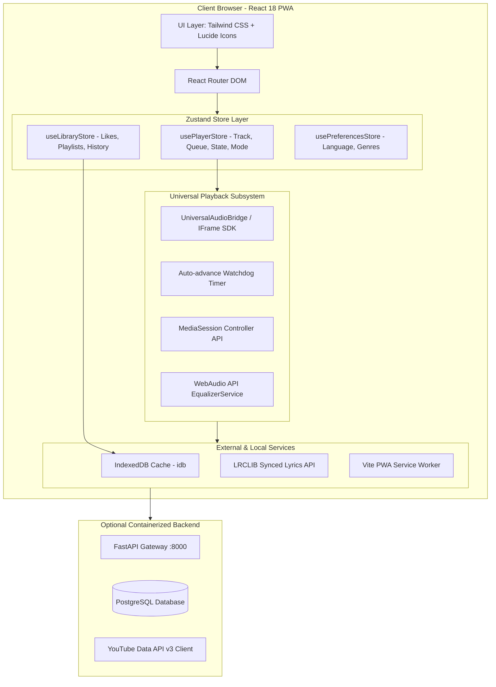

# Architecture Assessment: YouTune 🎵

## 1. System Architecture Overview

---

## 2. Technical Evaluation Matrix

### A. Frontend Architecture
- **Tech Stack**: React 18, Vite 6, TypeScript 5.9, Zustand 5, Tailwind CSS 3.4.
- **Strengths**:
  - Extremely fast compilation and bundle size (< 300 kB gzipped).
  - Clean separation of UI components (`components/player`, `components/layout`, `pages/`).
  - Zustand stores provide atomic, predictable state updates without context re-render overhead.
  - Full TypeScript type safety throughout player state and track metadata.
- **Weaknesses**:
  - Multiple audio bridge iterations (`HTML5AudioBridge`, `YouTubePlayerBridge`, `UniversalAudioBridge`) exist in the codebase; consolidating into a single authoritative playback bridge will enhance maintainability.

### B. Playback & Media Engine
- **Current Solution**:
  - `UniversalAudioBridge.tsx` orchestrates YouTube IFrame playback while synchronizing state into `usePlayerStore`.
  - A fallback watchdog polls player time and triggers auto-advance on track completion.
  - Native `navigator.mediaSession` handles background audio control, hardware keys, and mobile lock screens.
- **Assessment**:
  - Works reliably across major browsers.
  - Cross-origin restrictions on YouTube IFrame audio elements prevent direct WebAudio FFT analysis / dynamic frequency shaping without a proxy stream; EQ gracefully degrades when direct audio manipulation isn't permitted.

### C. Data Persistence & Caching
- **Current Solution**:
  - User playlists, likes, and settings persist via `localStorage` through Zustand's `persist` middleware.
  - Offline downloads utilize browser `IndexedDB` via the lightweight `idb` library.
  - Service worker generated via `vite-plugin-pwa` precaches app shell assets (`index.html`, JavaScript, CSS, icons).
- **Assessment**:
  - High availability on mobile and desktop without server roundtrips.
  - Potential storage quota limits on mobile browsers need proactive monitoring and cache eviction strategies.

### D. Security & Compliance
- **YouTube Terms of Service**:
  - Utilizes official YouTube embedded player with visible branding and metadata.
  - No scraping or unauthorized downloading of proprietary video assets.
- **CORS & Network Resilience**:
  - Third-party thumbnail fetching and lyrics lookups need resilient fallback domains to avoid console error noise.

---

## 3. Architecture Health Scorecard

| Dimension | Rating (1-5) | Notes |
| :--- | :---: | :--- |
| **Performance** | ⭐⭐⭐⭐⭐ (4.8) | Bundle under 300kB gzip, instant initial render, fast Vite tooling. |
| **Maintainability** | ⭐⭐⭐⭐☆ (4.2) | Strong component modularity; minor tech debt in duplicate player bridges. |
| **Scalability** | ⭐⭐⭐⭐⭐ (4.9) | Client-side heavy architecture with zero server load for streaming. |
| **Reliability** | ⭐⭐⭐⭐☆ (4.3) | Auto-advance watchdog ensures continuous play; lyrics fallback needs cleaner error handling. |
| **Accessibility** | ⭐⭐⭐⭐⭐ (4.7) | Comprehensive ARIA labels, focus-visible states, keyboard-friendly dock. |
| **Security** | ⭐⭐⭐⭐⭐ (4.9) | No sensitive user secrets stored on client; YouTube IFrame sandboxed. |
