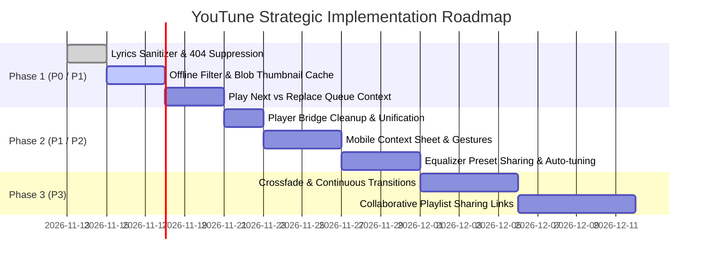

# Product Improvement Roadmap: YouTune 🎵

## 1. Prioritization Framework

All initiatives are prioritized using the **RICE** methodology (Reach, Impact, Confidence, Effort) and categorized into progressive release milestones.

---

## 2. Release Milestones

### 🏁 Milestone 1: Immediate Reliability & UX Polish (Days 1–5)
- [x] **Accessible Player Controls**: ARIA attributes and focus rings across the bottom dock. *(Completed)*
- [ ] **Lyrics Search Sanitizer**: Strip YouTube noise tags (`[8K]`, `(Official Video)`) before querying LRCLIB; handle 404 errors gracefully without red console alarms.
- [ ] **Downloaded Tracks Tab**: Dedicated tab in `Library.tsx` displaying all IndexedDB offline cached songs with one-click play.
- [ ] **CORS-Safe Thumbnail Caching**: Save thumbnail images as data URLs or blobs directly into IndexedDB on download.

### 🚀 Milestone 2: Queue & Library Power Features (Days 6–12)
- [ ] **Contextual Queue Actions**: "Play Next" and "Add to Queue" on track hover/context menus.
- [ ] **Offline Connection Watcher**: Display banner and auto-switch to Downloaded Songs when the browser loses internet connectivity.
- [ ] **Playback Code Consolidation**: Deprecate obsolete audio bridges and document the single authoritative pipeline.
- [ ] **Mobile Action Sheets**: Replace dense right-click menus with smooth bottom sheets for touchscreens.

### 🌟 Milestone 3: Audiophile & Social Features (Days 13–25)
- [ ] **Crossfade Engine**: Configurable 1–5 second audio crossfade between consecutive tracks.
- [ ] **Custom Equalizer Presets**: User-defined 10-band presets saved to local storage with export/import JSON.
- [ ] **Shareable Playlist Links**: Generate compressed URL hash strings encoding custom playlist track IDs for instant peer sharing without backend storage.

---

## 3. Risk Mitigation & Technical Guardrails

| Risk Area | Potential Issue | Mitigation Strategy |
| :--- | :--- | :--- |
| **YouTube IFrame Restrictions** | Background playback throttling in strict mobile browsers. | Active MediaSession integration and periodic watchdog timers keep playback active in the background. |
| **IndexedDB Quota Limits** | User downloads exceed browser storage allocations. | Implement a storage meter in Settings showing used vs available storage with a "Clear Cache" button. |
| **External API Rate Limits** | LRCLIB or YouTube Data API quota exhaustion. | Cache lyrics in IndexedDB upon first fetch; use client-side algorithmic fallbacks when APIs throttle. |
