# Product Overview: YouTune 🎵

## 1. Executive Summary
**YouTune** is a modern, Spotify-inspired web music streaming application that bridges high-fidelity UI design with YouTube's vast catalog of official music, performances, and user-curated audio. It operates as a client-side Progressive Web Application (PWA) capable of running both fully standalone in the browser (via direct YouTube Data API / embedded IFrame SDK with indexed local storage) and alongside a containerized FastAPI backend.

---

## 2. Target Users & Personas

| Persona | Needs & Goals | Pain Points Addressed |
| :--- | :--- | :--- |
| **Everyday Music Streamer** | High-aesthetic desktop and mobile experience; rich genre exploration and personalized playlists without subscription paywalls. | Avoids cumbersome official YouTube video UI when only interested in clean music playback and background audio. |
| **Power Listener / Audiophile** | Equalizer customization, synced lyrics tracking, sleep timers, and continuous radio autoplay. | Provides 10-band audio EQ presets and synced LRC lyrics integration without extra browser extensions. |
| **Commuter / Offline Listener** | Ability to save favorite tracks for offline playback and listen during intermittent connectivity. | IndexedDB client caching stores tracks and audio assets for offline listening. |

---

## 3. Product Purpose & Value Proposition
- **Spotify Aesthetics + YouTube Depth**: Combines dark-mode glassmorphic navigation, sticky playback dock, tracklists, and queue drawers with YouTube's unmatched audio catalog.
- **Zero-Friction Access**: Instant playback out of the box with embedded mock catalogs and client-side fallback engines—no forced login or API key setup required to begin listening.
- **PWA & Mobile Ready**: Offline caching, responsive mobile tab navigation, MediaSession lock screen integration, and background audio watchdog.

---

## 4. Core Features & Capabilities

```mermaid
mindmap
  root((YouTune))
    Playback Engine
      YouTube IFrame Bridge
      MediaSession API
      10-Band WebAudio EQ
      Synced LRCLIB Lyrics
      Auto-advance Watchdog
    Music Discovery
      Curated Mixes & Charts
      Genre Explorer
      Live Search with Debounce
      Smart Radio Algorithm
    User Library
      Liked Tracks
      Custom Playlists
      Recently Played History
      IndexedDB Offline Vault
    PWA Experience
      Service Worker Caching
      Mobile Navigation Bar
      Installable Web App
```

1. **Playback & Media Control**:
   - YouTube IFrame Player engine synced with an interactive playback bar.
   - Dynamic MediaSession integration (lock-screen metadata, next/prev/play/pause controls).
   - Synced lyrics via LRCLIB with autoscroll.
   - 10-band equalizer with presets (Bass Boost, Vocal, Electronic, Flat, Rock).
2. **Discovery & Browsing**:
   - Dynamic Home feed (Trending charts, Quick Picks, Daily Mixes).
   - Genre explorer with filtered mood categorization.
   - Search autocomplete and query sanitization.
3. **Library Management**:
   - Persistent Liked Songs, user playlists, and playback history stored via Zustand with local/IndexedDB persistence.
   - Offline download and local cached audio playback.
4. **Onboarding & Personalization**:
   - First-time user preference questionnaire (favorite artists, genres, language preferences) adapting the recommendation engine.

---

## 5. Business Model & Operational Context
- **Hosting / Distribution**: GitHub Pages client-side static deployment with optional self-hosted Docker Compose (Nginx + FastAPI + PostgreSQL).
- **Compliance Model**: YouTube Developer Policy & Terms of Service compliant by utilizing the official embedded IFrame player with visual attribution and channel metadata rather than extracting raw stream binaries.
- **Monetization Potential**: Free/open-source model with potential for optional self-hosted sync tokens or community plugin integrations.
