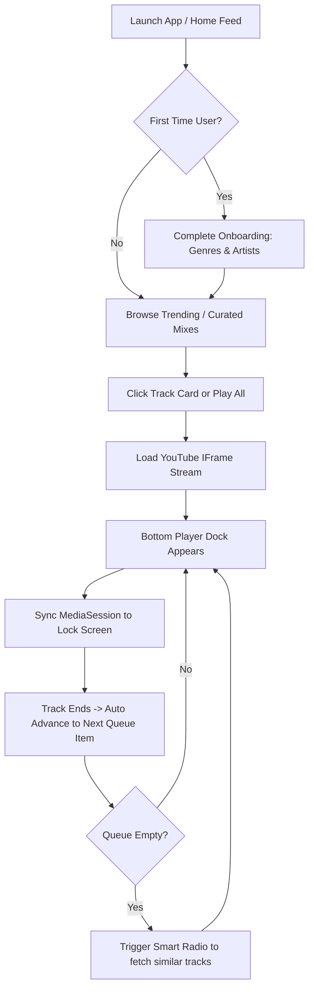
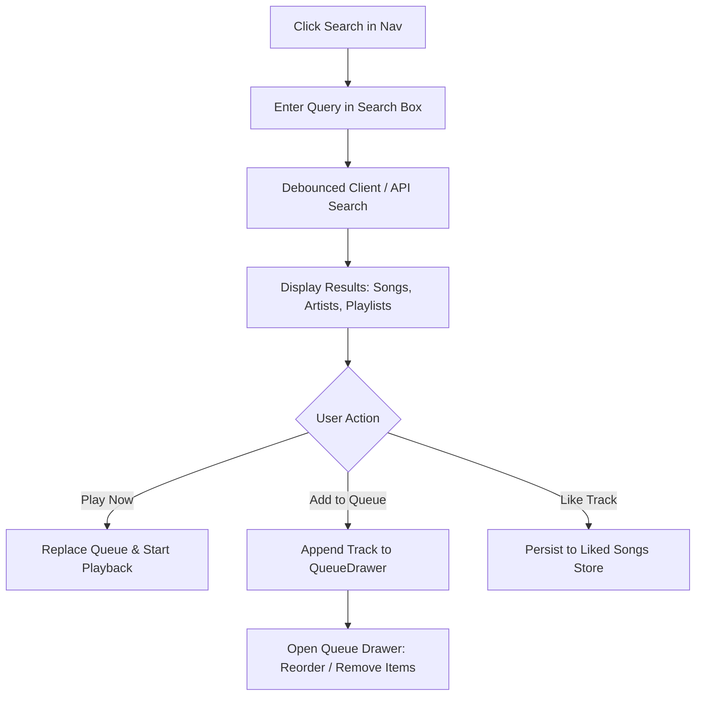
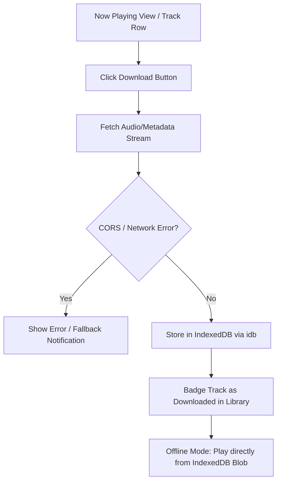
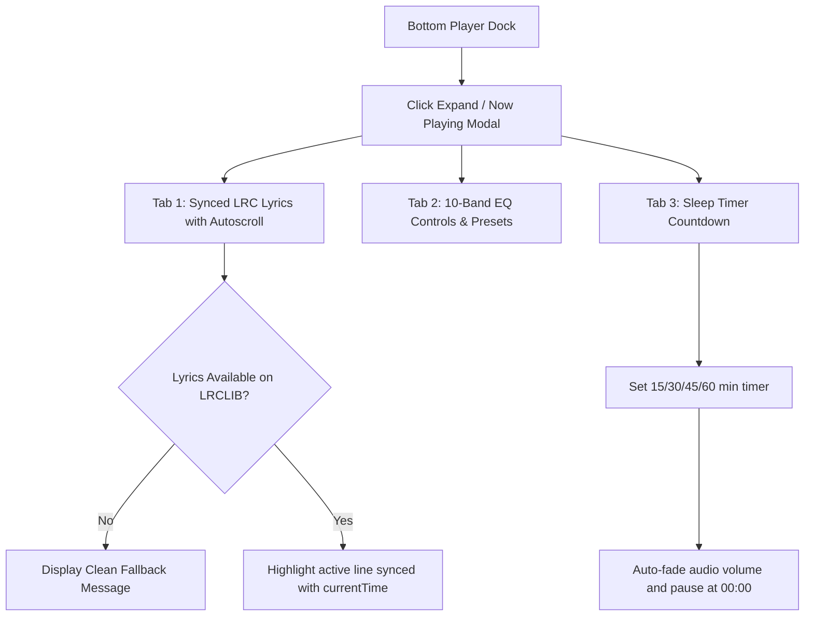

# User Workflow Analysis: YouTune 🎵

## 1. Primary User Journeys

### Journey 1: Music Discovery to Continuous Playback

- **Observed Friction**:
  - When the user clicks play on an isolated track from Search or an album, if the queue isn't pre-populated, the track plays alone and auto-advance halts unless Smart Radio is toggled on.
  - Video loading spinner in the bottom dock can occasionally obscure track metadata while buffering.

---

### Journey 2: Search, Filter, and Queue Management

- **Observed Friction**:
  - Clicking a song directly in search results currently replaces the active playback context instead of prompting or asking whether to enqueue next or replace the current session.
  - Adding tracks to custom playlists from track rows requires navigating through multiple nested menu interactions on mobile screens.

---

### Journey 3: Offline Download and Playback

- **Identified Workflow Gaps**:
  - Direct thumbnail image fetches from third-party CDN domains (e.g. `yt.chocolatemoo53.com`) can encounter CORS blocks if not routed through reliable proxy fallback URLs.
  - No clear visual banner or offline switch in the top navbar alerting the user when their internet connection drops, though PWA assets are cached.

---

### Journey 4: Audio Customization (Equalizer, Lyrics, Sleep Timer)

- **Identified Bottlenecks**:
  - WebAudio API context creation requires an un-tainted audio element; when YouTube IFrame cross-origin restrictions apply, EQ adjustments may be bypassed to avoid audio silence.

---

## 2. Summary of Identified UX & Workflow Opportunities

| Opportunity | Workflow Stage | User Impact | Priority |
| :--- | :--- | :--- | :--- |
| **Play Next vs Replace Queue** | Search & Library | Prevents accidentally blowing away an active 20-song listening queue. | **P1** |
| **Visual Offline Mode Toggle** | Library / TopBar | Clearly shows which tracks are ready to listen without internet. | **P1** |
| **Contextual Menu on Mobile** | TrackRow | Long-press or 3-dot bottom sheet for faster playlist addition. | **P2** |
| **Persistent Volume Memory** | BottomPlayer | Restores last volume and mute state seamlessly across sessions. | **P2** |
| **Lyrics Search Fallback Refinement** | NowPlayingModal | Normalizes track titles (strips `(Official Video)`, `8K`, `HD`) before querying LRCLIB. | **P1** |
