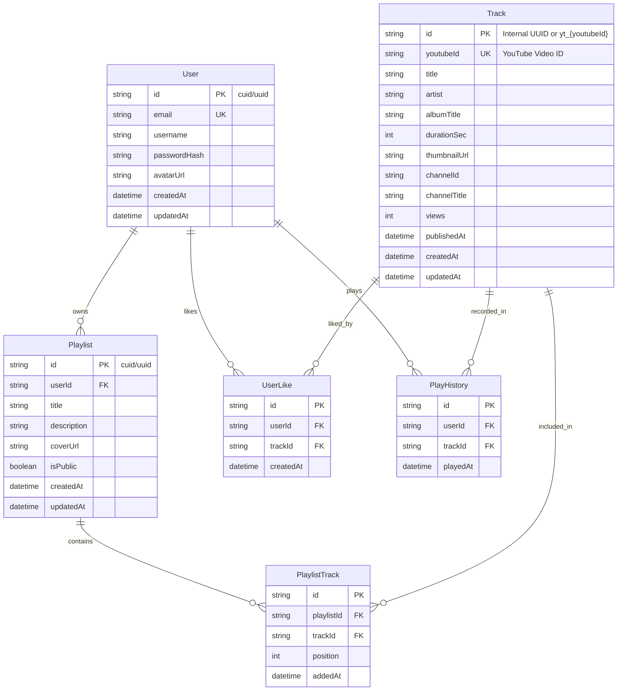

# Database Schema Design & Migration Plan

## 1. Overview
The database uses Prisma ORM or a dual-compatible SQLite/PostgreSQL schema.
- **Development/Test fallback**: SQLite (`file:./dev.db`)
- **Production/Staging**: PostgreSQL

## 2. Entity-Relationship (ER) Model



## 3. Prisma Schema Reference (`prisma/schema.prisma`)

```prisma
datasource db {
  provider = "sqlite" // or "postgresql" via env("DATABASE_URL")
  url      = env("DATABASE_URL")
}

generator client {
  provider = "prisma-client-js"
}

model User {
  id           String        @id @default(uuid())
  email        String        @unique
  username     String
  passwordHash String
  avatarUrl    String?
  createdAt    DateTime      @default(now())
  updatedAt    DateTime      @updatedAt

  playlists    Playlist[]
  likes        UserLike[]
  history      PlayHistory[]
}

model Track {
  id           String          @id @default(uuid())
  youtubeId    String          @unique
  title        String
  artist       String
  albumTitle   String?
  durationSec  Int             @default(0)
  thumbnailUrl String
  channelId    String?
  channelTitle String?
  views        Int?            @default(0)
  publishedAt  DateTime?
  createdAt    DateTime        @default(now())
  updatedAt    DateTime        @updatedAt

  playlistTracks PlaylistTrack[]
  likes          UserLike[]
  playHistories  PlayHistory[]

  @@index([youtubeId])
  @@index([artist])
}

model Playlist {
  id          String          @id @default(uuid())
  userId      String
  title       String
  description String?
  coverUrl    String?
  isPublic    Boolean         @default(true)
  createdAt   DateTime        @default(now())
  updatedAt   DateTime        @updatedAt

  user        User            @relation(fields: [userId], references: [id], onDelete: Cascade)
  tracks      PlaylistTrack[]

  @@index([userId])
}

model PlaylistTrack {
  id         String   @id @default(uuid())
  playlistId String
  trackId    String
  position   Int
  addedAt    DateTime @default(now())

  playlist   Playlist @relation(fields: [playlistId], references: [id], onDelete: Cascade)
  track      Track    @relation(fields: [trackId], references: [id], onDelete: Cascade)

  @@unique([playlistId, trackId])
  @@index([playlistId, position])
}

model UserLike {
  id        String   @id @default(uuid())
  userId    String
  trackId   String
  createdAt DateTime @default(now())

  user      User     @relation(fields: [userId], references: [id], onDelete: Cascade)
  track     Track    @relation(fields: [trackId], references: [id], onDelete: Cascade)

  @@unique([userId, trackId])
  @@index([userId])
}

model PlayHistory {
  id        String   @id @default(uuid())
  userId    String
  trackId   String
  playedAt  DateTime @default(now())

  user      User     @relation(fields: [userId], references: [id], onDelete: Cascade)
  track     Track    @relation(fields: [trackId], references: [id], onDelete: Cascade)

  @@index([userId, playedAt])
}
```

## 4. Migration Plan & Local Setup
1. **Local SQLite Migration**:
   - `DATABASE_URL="file:./dev.db"`
   - Run `npx prisma migrate dev --name init` or `npx prisma db push` for instantaneous zero-config local testing.
2. **PostgreSQL Production Switch**:
   - Change datasource provider to `postgresql` or configure via environmental connection string.
   - Run `npx prisma migrate deploy`.
